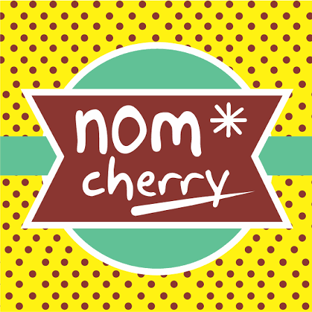

# 🍒 NomCherry Café
**Sistem Informasi Pemesanan & Kasir Kafe Berbasis Web dengan Metode Waterfall**

[](https://nodejs.org/)
[](https://expressjs.com/)
[-003B57?logo=sqlite&logoColor=white)](https://nodejs.org/api/sqlite.html)
[](https://github.com/Daff77/ProjekCafePBO)
[](#-desain-sistem-parley-ui--kepatuhan-anti-slop)
[-brightgreen)](#-matriks-pengujian-black-box-tabel-512-rpl)

---

<p align="center">
  
  <br>
  <em>"Sweet Moments, Perfect Sips"</em>
</p>

## 📌 Ringkasan Proyek

**NomCherry Café** adalah sistem informasi kasir (*Point of Sale / POS*) dan operasional kafe multi-cabang berbasis web yang dibangun berdasarkan spesifikasi akademik pada **[`LAPORAN TUGAS RPL.md`](LAPORAN%20TUGAS%20RPL.md)** menggunakan **Metode Waterfall**.

Repositori ini merepresentasikan hasil **restrukturisasi total & modernisasi arsitektur** dari proyek Java Swing desktop monolitik lama (`ProjekCafePBO/`) menjadi **Layered Clean Web Architecture** yang ringan, modular, zero-dependency, serta mengadopsi standar desain visual dari **Parley Messaging Analytics Dashboard** dengan kepatuhan penuh terhadap prinsip **Anti-Slop UX**.

---

## 🏛️ Transformasi Arsitektur: Sebelum vs Sesudah

```mermaid
flowchart TD
    subgraph LAMA["❌ Arsitektur Awal (Desktop Java Swing Monolith)"]
        A1["Java Swing UI (Grey Native Forms)"] --> A2["Controller & Business Logic Campur di UI"]
        A2 --> A3["Wajib PostgreSQL Server Port 5432 Aktif"]
        A3 --> A4["Folder Bertumpuk: ProjekCafePBO/ProjekCafePBO"]
    end

    subgraph BARU["✅ Arsitektur Baru (NomCherry Web - Layered Clean Architecture)"]
        B1["Presentation Layer (Parley SPA: HTML5 / CSS3 / Vanilla JS)"]
        B2["API Gateway & Routing (Express REST API)"]
        B3["Controller & Business Logic Layer (Auth, POS, Menu, Stok, Laporan)"]
        B4["Data Access Layer (Node.js Native DatabaseSync / SQLite 3.53)"]
        
        B1 <--> B2
        B2 <--> B3
        B3 <--> B4
    end
```



### 🌟 Keunggulan Arsitektur Baru:
1. **Zero-Dependency Setup**: Menggunakan fitur bawaan *Node.js Native DatabaseSync* (SQLite 3.53). Database `nomcherry.db` otomatis terbuat dan terisi data awal (*auto-seed*) seketika saat aplikasi pertama kali dijalankan tanpa perlu instalasi PostgreSQL terpisah.
2. **Separation of Concerns (SoC)**: Logika bisnis, kendali API, dan aset presentasi terisolasi secara bersih di folder masing-masing.
3. **Multi-Role & Multi-Cabang**: Mendukung 4 tingkatan peran (*Admin, Kasir, Manager, Owner*) dengan pembatasan hak akses (*Role Guard*) serta pemisahan data antara **Cabang 1 (Surabaya Pusat)** dan **Cabang 2 (Surabaya Timur)**.
4. **Thermal Receipt Engine**: Menghasilkan struk kasir thermal standar 58mm/80mm dengan motif tepi kertas bergerigi, barcode SVG, info Wi-Fi, dan cetak presisi bebas border browser (`@media print`).

---

## 🎨 Desain Sistem: Parley UI & Kepatuhan Anti-Slop

Desain antarmuka web mengadopsi token visual dari referensi **Parley Dashboard** dan mengikuti pedoman ketat **Anti-Slop UI**:

| Token Desain | Nilai / Implementasi | Karakter Visual |
| :--- | :--- | :--- |
| **Surface Background** | `#efe9e1` (Warm Cream) | Lembut di mata dengan soft ambient gradient |
| **Cards & Modals** | `#fffdf9` (Crisp Eggshell) | Radius `22px` terarah dengan elevasi bayangan halus |
| **Plum Ink Typography**| `#221b26` (Headlines) & `#554b5a` (Body) | Tipografi tajam memakai *Bricolage Grotesque* & *Geist* |
| **Primary Brand Accent**| `#7a2228` (Cherry Maroon) & `#bf3f1b` | Aksen tombol utama, identitas brand kafe, dan live badge |
| **Secondary Accents**  | `#1e9a8a` (Mint Teal) & `#f5ce2b` (Yellow) | Status sukses/QRIS dan highlight peran |
| **Navigation Rail**    | Deep Charcoal Ink `#221b26` | Sidebar kiri sticky dengan sliding pill indicator aktif |
| **Top Header Bar**     | Sapaan dinamis waktu, branch picker pill, sync badge live, pencarian instan <kbd>⌘K</kbd> / <kbd>Ctrl+K</kbd> |

> [!NOTE]
> **Kepatuhan Anti-Slop**:
> - ❌ *Zero AI-Gradients*: Tidak ada gradien biru-ungu generik atau orbs neon template AI.
> - ❌ *Zero Excessive Glassmorphism*: Tidak ada blur/backdrop-filter berlebihan yang mengorbankan keterbacaan.
> - ✅ *Authentic Copywriting*: Seluruh teks menu, deskripsi rasa, dan alur nota dibuat otentik untuk operasional kafe nyata.

---

## 🍽️ Katalog 24 Menu Autentik & Foto Asli

Sistem dilengkapi **24 menu kafe bervariasi** lengkap dengan foto resolusi tinggi, harga, stok, dan deskripsi:

| No | Kategori | Nama Menu | Harga | Deskripsi Rasa |
| :---: | :--- | :--- | :---: | :--- |
| 1 | **Minuman (Kopi)** | **NomCherry Signature Cold Brew** | Rp 28.000 | Kopi seduh dingin 18 jam dengan sirup cherry murni & cold foam |
| 2 | **Minuman (Kopi)** | **Caramel Macchiato Velvet** | Rp 26.000 | Espresso double shot, vanilla Madagaskar & saus karamel leleh |
| 3 | **Minuman (Kopi)** | **Spanish Latte Sweet Cream** | Rp 25.000 | Paduan espresso pekat dengan condensed milk creamy khas Spanyol |
| 4 | **Minuman (Kopi)** | **Cappuccino Creamy Oat Milk** | Rp 27.000 | Espresso robusta-arabika dengan susu oat lembut & cokelat Belgia |
| 5 | **Minuman (Kopi)** | **Affogato Al Caffe Vanilla** | Rp 24.000 | Dua scoop gelato vanila artisan disiram espresso single origin panas |
| 6 | **Minuman (Kopi)** | **Kopi Hitam Nusantara** | Rp 18.000 | Americano klasik blend robusta Dampit dan arabika Gayo |
| 7 | **Non-Coffee** | **Artisan Uji Matcha Latte** | Rp 26.000 | Matcha grade seremonial asli Uji, Kyoto dengan susu segar dingin |
| 8 | **Non-Coffee** | **NomCherry Berry Sparkler** | Rp 22.000 | Soda mocktail dengan puree cherry segar, buah berry merah & mint |
| 9 | **Non-Coffee** | **Taro Velvet Frappe** | Rp 24.000 | Minuman taro ungu pekat di-blend es krim & cheese mascarpone |
| 10 | **Non-Coffee** | **Earl Grey Milk Tea with Boba** | Rp 23.000 | Teh hitam bergamot aromatik dengan boba brown sugar kenyal |
| 11 | **Non-Coffee** | **Belgian Dark Chocolate Hazelnut** | Rp 25.000 | Cokelat Belgia 70% kental dengan pasta hazelnut panggang |
| 12 | **Non-Coffee** | **Teh Manis Melati Heritage** | Rp 8.000 | Teh seduh daun melati tradisional dengan pemanis tebu murni |
| 13 | **Non-Coffee** | **Es Teh Lemon Mint Fresh** | Rp 12.000 | Es teh melati segar dengan perasan lemon asli dan madu hutan |
| 14 | **Makanan Utama** | **Spaghetti Aglio Olio Smoked Beef** | Rp 34.000 | Pasta al dente ditumis olive oil, cabai kering & irisan daging asap |
| 15 | **Makanan Utama** | **Japanese Chicken Katsu Curry** | Rp 38.000 | Fillet ayam renyah dengan kuah kari Jepang kental harum & nasi |
| 16 | **Makanan Utama** | **NomCherry Beef Truffle Burger** | Rp 42.000 | Patty sapi 150g, keju cheddar, truffle aioli & caramelized onion |
| 17 | **Makanan Utama** | **Chicken Teriyaki Rice Bowl** | Rp 32.000 | Ayam panggang teriyaki manis gurih, tamagoyaki & biji wijen |
| 18 | **Makanan Utama** | **Mie Goreng Spesial Kafe** | Rp 24.000 | Mie telur kenyal bumbu rempah kafe, telur mata sapi & bakso |
| 19 | **Snack** | **Truffle Parmesan French Fries** | Rp 22.000 | Kentang goreng renyah dengan minyak truffle & keju parmesan |
| 20 | **Snack** | **Golden Crispy Chicken Popcorn** | Rp 25.000 | Ayam renyah berbumbu garlic pepper dengan dipping spicy mayo |
| 21 | **Dessert** | **NomCherry Basque Burnt Cheesecake**| Rp 32.000 | Cheesecake karamel gosong lembut dengan compote cherry manis asam |
| 22 | **Dessert** | **Butter Croissant with Berry Compote**| Rp 26.000 | Pastry mentega Prancis hangat berlapis renyah disajikan dengan selai berry |
| 23 | **Dessert** | **Japanese Fluffy Souffle Pancake** | Rp 30.000 | Dua susun pancake awan bergoyang dengan sirup maple & butter |
| 24 | **Dessert** | **Classic Belgian Waffle with Ice Cream**| Rp 28.000 | Wafel Belgia garing di luar dengan es krim vanila & cokelat |

---

## ⚡ Fitur Utama & Modul Sistem

### 1. Modul Kasir / Point of Sale (POS)
- Katalog visual dengan foto makanan asli, status stok (*Ready / Menipis / Habis*), dan tombol tambah cepat `+`.
- Pencarian instan real-time & tab filter kategori.
- Keranjang belanja interaktif dengan kalkulasi otomatis: Subtotal, Diskon Promo, PB1 Resto (10%), dan Grand Total.
- Validasi pencegahan pemesanan melebihi stok yang tersedia.

### 2. Multi-Metode Pembayaran & Cetak Struk Kasir
- Mendukung metode: **Tunai (Cash)** dengan chips nominal cepat (*Uang Pas, 20k, 50k, 100k*), **QRIS Digital** (mockup QR), **Kartu Debit**, dan **Transfer Bank**.
- Pratinjau struk fisik format thermal kasir (58mm/80mm) bertepi kertas bergerigi (*serrated paper edge*), barcode SVG, dan detail kasir/meja.
- Cetak bersih bebas border browser menggunakan stylesheet cetak presisi (`@media print`).

### 3. Manajemen Inventaris & Deteksi Bahan Kadaluarsa
- Pemantauan level stok (*Aman, Menipis ≤5, Habis*).
- Form penyesuaian stok masuk (*restock*), barang keluar, atau koreksi fisik.
- Riwayat pencatatan mutasi inventaris otomatis setiap kali terjadi transaksi penjualan.
- **Deteksi Kadaluarsa**: Label visual otomatis `⚠️ EXPIRED` jika tanggal kadaluarsa telah lewat dan `Mendekati Exp` jika kadaluarsa dalam 2-3 hari.

### 4. Dashboard Finansial Parley & Analitik Eksekutif
- Metrik omset hari ini dengan tag `Live` berdenyut (*pulsing indicator*).
- Grafik *bar chart* transaksi bulanan interaktif bergaya wells khas Parley.
- Top 5 menu terlaris (*best seller ranking*).
- Kartu perbandingan transaksi & omset antar cabang (Surabaya Pusat vs Surabaya Timur).

### 5. Laporan Penjualan & Ekspor CSV
- Filter laporan berdasarkan rentang tanggal awal, tanggal akhir, dan cabang kafe.
- Ringkasan omset total, total transaksi, total pajak PB1, dan rata-rata belanja (*basket size*).
- Breakdown pendapatan per metode pembayaran.
- Tombol ekspor instan ke format file **`.csv`** siap olah di Microsoft Excel atau Google Sheets.

### 6. Manajemen Akun Pengguna & Multi-Cabang
- Manajemen pengguna lengkap dengan hak akses peran (*Role Guard*).
- Modal cepat **Switch User** (klik avatar di pojok kanan atas) untuk berpindah peran seketika tanpa perlu ketik ulang kredensial.
- Pintasan keyboard universal **<kbd>Ctrl+K</kbd> / <kbd>⌘K</kbd>** untuk memunculkan *Command Palette*.

---

## 👥 Akun Demo untuk Pengujian

| Peran (Role) | Username | Password | Penugasan Cabang | Cakupan Hak Akses |
| :--- | :--- | :--- | :--- | :--- |
| **Admin** | `admin` | `admin123` | Semua Cabang | **Full Akses** (Menu, Stok, Transaksi, Laporan, Manajemen User & Cabang) |
| **Kasir Cabang 1** | `daps` | `135` | Cabang 1 (Pusat) | Transaksi POS & Cetak Struk di Surabaya Pusat |
| **Kasir Cabang 2** | `kasir` | `123` | Cabang 2 (Timur) | Transaksi POS & Cetak Struk di Surabaya Timur |
| **Manager** | `manager1` | `123` | Semua Cabang | Pengelolaan Stok Gudang, Kadaluarsa, Katalog Menu & Laporan |
| **Owner** | `owner1` | `123` | Semua Cabang | Monitoring Omset Eksekutif & Analitik Antar Cabang |

---

## 🧪 Matriks Pengujian Black Box (Tabel 5.1.2 RPL)

Seluruh 16 skenario pengujian fungsional pada Bab 5 Laporan RPL telah divalidasi melalui test suite otomatis:

| ID Uji | Fitur | Skenario Pengujian | Hasil Sistem Baru | Status |
| :---: | :--- | :--- | :--- | :---: |
| **TC-01** | Login | Login dengan kredensial benar (Admin) | Berhasil login dan diarahkan ke Dashboard | **LULUS** |
| **TC-02** | Login | Login dengan password salah | Menampilkan pesan error *"Password salah"* | **LULUS** |
| **TC-03** | Login | Kasir Cabang 1 login di Cabang 2 | Ditolak: *"Anda tidak terdaftar di cabang ini"* | **LULUS** |
| **TC-04** | Login | Field username/password kosong | Menolak login: *"Field tidak boleh kosong"* | **LULUS** |
| **TC-05** | Menu | Ketersediaan katalog 24 menu | 24 menu aktif termuat dari database | **LULUS** |
| **TC-06** | Menu | Filter kategori (Minuman, Makanan, dll.)| Menu terfilter rapi sesuai kategori | **LULUS** |
| **TC-07** | Menu | Pencarian menu berdasarkan kata kunci | Menampilkan menu sesuai keyword yang dicari | **LULUS** |
| **TC-08** | POS | Item stok 0 / melebihi stok yang ada | Ditolak: *"Stok tidak cukup"* / *"Stok habis"* | **LULUS** |
| **TC-09** | POS | Checkout pesanan & perhitungan pajak | Transaksi sukses, PB1 10% terhitung presisi | **LULUS** |
| **TC-10** | Stok | Pemotongan stok otomatis saat checkout | Stok berkurang seketika sesuai kuantitas order | **LULUS** |
| **TC-11** | Struk | Pratinjau struk kasir thermal 80mm/58mm | Struk thermal terbit dengan nomor unik & barcode | **LULUS** |
| **TC-12** | Gudang | Deteksi tanggal bahan kadaluarsa | Menampilkan badge `⚠️ EXPIRED` & `Mendekati Exp`| **LULUS** |
| **TC-13** | Laporan | Rekapitulasi penjualan berdasarkan cabang | Data transaksi terhitung akurat sesuai filter | **LULUS** |
| **TC-14** | Laporan | Ekspor laporan penjualan ke CSV | Mengunduh file `.csv` valid dengan header lengkap | **LULUS** |
| **TC-15** | Parley | Grafik tren bulanan & performa cabang | 12 titik bar chart & komparasi cabang tampil | **LULUS** |
| **TC-16** | Cabang | Manajemen outlet cabang kafe | Data master cabang Surabaya Pusat & Timur aktif | **LULUS** |

---

## 🚀 Panduan Menjalankan Aplikasi

### Prasyarat
- **Node.js** versi 18.x, 20.x, atau 26.x ([Unduh Node.js](https://nodejs.org/))
- Web browser modern (Chrome, Edge, Firefox, Safari)

### Cara 1: Menggunakan Launcher Sekali Klik (Rekomendasi Windows)
Cukup klik ganda file berikut pada root folder:
👉 **`start-web.bat`**

*Script akan otomatis mengarahkan ke folder `nomcherry-web/`, membuka browser di `http://localhost:3000`, dan menjalankan server.*

### Cara 2: Melalui Terminal / Command Prompt
```bash
# 1. Masuk ke direktori web app
cd nomcherry-web

# 2. Install dependensi (hanya perlu dijalankan sekali)
npm install

# 3. Jalankan server aplikasi
npm start

# 4. Buka di browser
# http://localhost:3000
```

### Cara Menjalankan Test Suite Otomatis
```bash
cd nomcherry-web

# Menjalankan 12 uji Black Box spesifikasi RPL
node tests/test-nomcherry.js

# Menjalankan audit menyeluruh 16 fitur sistem
node tests/audit-all-features.js
```

---

## 📁 Struktur Direktori Repositori

```
ProjekCafePBO/
├── README.md                      # Dokumentasi komprehensif sistem NomCherry Café
├── .gitignore                     # Konfigurasi pengabaian file Git
├── start-web.bat                  # Launcher web app 1-klik untuk Windows
├── nomcherry-logo.png             # Asset resmi logo kafe "nom* cherry"
├── LAPORAN TUGAS RPL.md           # Laporan akademik sistem kafe (Metode Waterfall)
├── db_kafe.sql                    # Skema database SQL asli
│
├── nomcherry-web/                 # APLIKASI WEB UTAMA (Layered Clean Architecture)
│   ├── package.json               # Konfigurasi dependensi Express & npm script
│   ├── package-lock.json
│   ├── tests/                     # Automated Test Suites
│   │   ├── test-nomcherry.js      # Verifikasi 12 skenario Black Box
│   │   └── audit-all-features.js  # Audit menyeluruh 16/16 fitur sistem
│   ├── src/                       # Backend Logic & REST API
│   │   ├── server.js              # Server entry point & Express middleware
│   │   ├── routes/
│   │   │   └── api.js             # Router endpoint REST API
│   │   ├── controllers/           # Business Logic Controllers
│   │   │   ├── authController.js  # Login, validasi, & pembatasan peran/cabang
│   │   │   ├── menuController.js  # CRUD Menu, kategori & penomoran otomatis
│   │   │   ├── orderController.js # Checkout POS, struk & pengurangan stok
│   │   │   ├── stockController.js # Penyesuaian stok, mutasi & kadaluarsa
│   │   │   ├── reportController.js# Dashboard Parley, analitik & ekspor CSV
│   │   │   └── branchController.js# Data master cabang kafe
│   │   └── database/
│   │       ├── db.js              # Connector SQLite Native & auto-seeder
│   │       └── nomcherry.db       # Database SQLite persistensi lokal
│   └── public/                    # Frontend Single Page Application (SPA)
│       ├── index.html             # Layout utama (Parley Rail, Header, Modals)
│       ├── assets/
│       │   └── logo.png           # Asset logo untuk UI & struk kasir
│       ├── css/
│       │   ├── parley-theme.css   # Token warna, tipografi, rail & hero cards Parley
│       │   └── nomcherry-components.css # Komponen POS, struk thermal, modal & tabel
│       └── js/
│           ├── api.js             # REST API fetch client
│           ├── app.js             # SPA router, manajemen sesi, & shortcut Cmd+K
│           ├── dashboard.js       # Metrik analitik & bar chart bulanan Parley
│           ├── pos.js             # Katalog 24 menu, keranjang, checkout & cetak struk
│           ├── menu.js            # Pengelolaan katalog menu & modal tambah/edit
│           ├── stock.js           # Inventaris bahan, mutasi stok & peringatan expired
│           ├── reports.js         # Laporan penjualan, filter & unduh CSV
│           └── users.js           # Manajemen pengguna & cabang
│
└── ProjekCafePBO/                 # Source Code Java NetBeans Desktop (Arsip PBO)
    ├── nbproject/
    └── src/                       # Source Java MVC (Model, View, Controller)
```

---

## 📄 Lisensi & Tim Pengembang

Proyek ini dikembangkan oleh **Daffa Danendra (Daff77)** untuk memenuhi tugas **Rekayasa Perangkat Lunak (RPL)** dengan spesifikasi sistem informasi pemesanan dan kasir berbasis web pada **NomCherry Café**.

*"Sweet Moments, Perfect Sips — Powered by Clean Architecture & Parley Design"*
